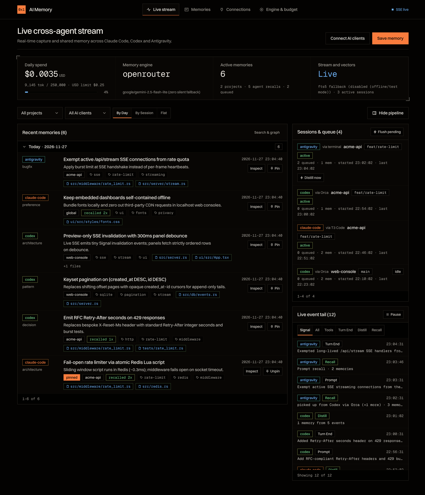
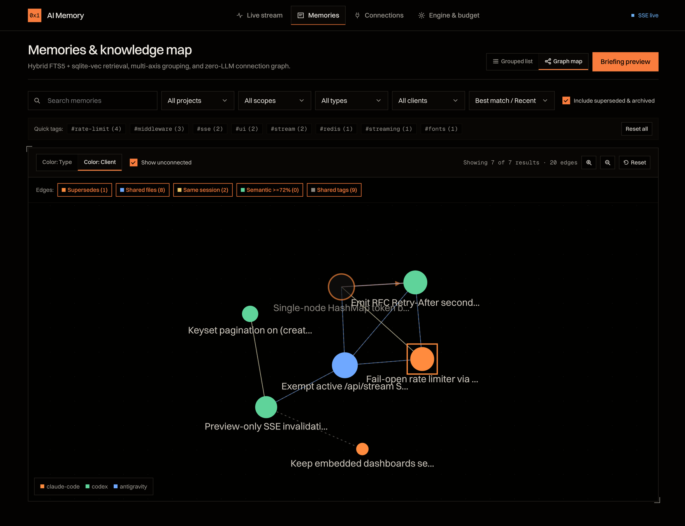
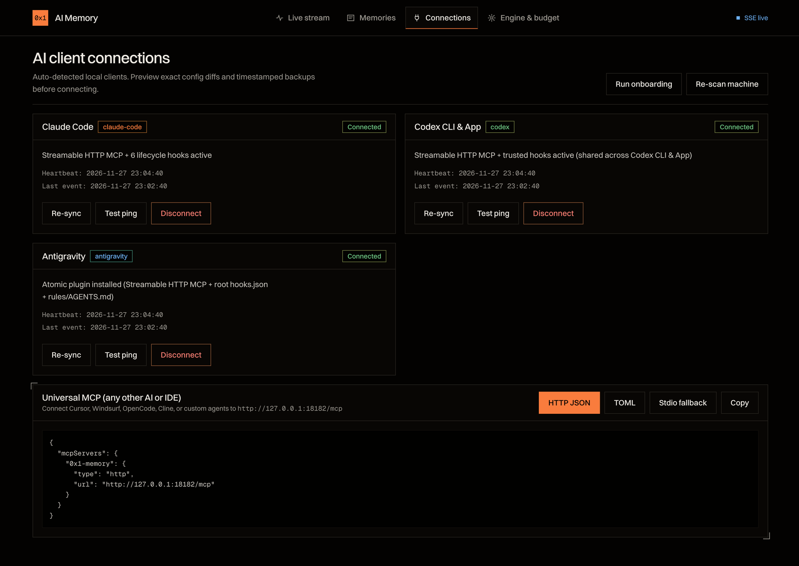
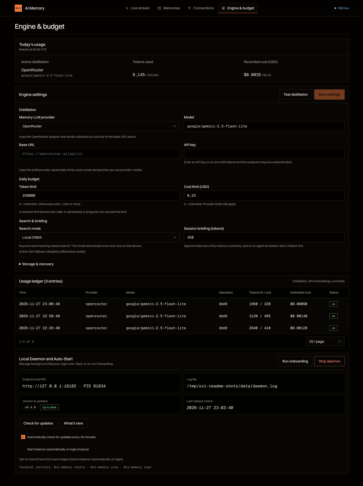

<p align="center">
  
</p>
<h1 align="center">0x1-ai-memory</h1>
<p align="center">
  <em>Shared, local-first memory for Claude Code, Codex, and Antigravity. One Rust binary, zero extra runtimes, zero subscription drain.</em>
</p>
<p align="center">
  <a href="https://www.npmjs.com/package/0x1-ai-memory"></a>
  <a href="https://github.com/raihan0x1/0x1-ai-memory/releases"></a>
  <a href="https://github.com/raihan0x1/0x1-ai-memory/actions/workflows/ci.yml"></a>
  <a href="https://sonarcloud.io/summary/new_code?id=raihan0x1_0x1-ai-memory"></a>
  <a href="LICENSE"></a>
</p>
<p align="center">
  
</p>
<p align="center">
  <strong>~9 ms hook overhead &middot; 1 SQLite WAL file &middot; 0 external runtimes &middot; cross-agent Handoff</strong><br>
  <sub>Connects Claude Code, Codex CLI &amp; App, Antigravity, and any Streamable HTTP MCP client from <code>http://127.0.0.1:10101</code>.</sub>
</p>

---

## Why 0x1-ai-memory?

Inspired by (and engineered to fix the root causes audited in [`docs/research/claude-mem-analysis.md`](docs/research/claude-mem-analysis.md)):

- **Anti-drain by design.** Hooks record prompts, tool errors, and turn ends locally at **0 LLM tokens** (<10 ms) and fail open if the Daemon is stopped. Stateless distillation runs once per turn (or on idle / `PreCompact`), not per-file `Read`/`Grep` replay.
- **Zero silent fallback.** Distillation runs on OpenRouter, Gemini, Ollama (local), any OpenAI-compatible endpoint, or **Zero-LLM ($0)** — never silently falling back onto your coding subscription when an API fails. Hard daily token and USD caps enforce spend before every call.
- **Cross-agent Handoff & time-anchored Recall.** When one agent hits a quota wall and you switch to another, the fresh session starts with a **Handoff** of recent project sessions, scrubbed prompts, active memories, and local timestamps anchored back to generation time.
- **Offline-first & private.** Single Rust binary using SQLite WAL + FTS5 + `sqlite-vec` + lazy local ONNX (`fastembed`), bundled UI fonts (zero external font hosts), deterministic secret & `<private>` scrubbing, and per-project `Full` / `Local-only` / `Paused` privacy controls.

## Switching agents mid-task (Handoff)

Starting a fresh session (`SessionStart`) builds a compact token-budgeted Briefing anchored to the local clock so agents know whether a memory happened minutes ago or yesterday — plus up to three recent other sessions in the same project from the last 12 hours:

```markdown
# 0x1-ai-memory (Cross-Agent Briefing)
Generated at 2026-11-27 23:02 UTC+07:00. Memory times are local; each age counts back from this moment.
Use `memory_get([id])` for full details or `memory_search(query)` for older context.

## Handoff (Recent Other Sessions)
- Codex via Orca (22:54, 8m before this briefing; 0 undistilled events):
  - Prompt: "Add RFC-compliant Retry-After headers and 429 burst tests covering window rollover"
  - Memories: Emit RFC Retry-After seconds on 429 responses (id:mem_...)
- Claude Code via T3 Code (22:46, 16m before this briefing; 0 undistilled events):
  - Prompt: "Move token-bucket rate limiter from in-memory HashMap to Redis Lua script with atomic sliding window"
  - Memories: Fail-open rate limiter via atomic Redis Lua script (id:mem_...)
```

Handoff runs only on fresh startups (skipped for `/clear`, `/compact`, `/resume`, and `Paused` projects), queues undistilled Handoff sessions asynchronously without slowing hook startup, and logs every injection as a `Recall` event in the Stream tail.

## Inside the console

### Memories & Lineage Graph

<p align="center">
  
</p>

Hybrid FTS5 + `sqlite-vec` search across projects and global preferences, interactive `Briefing preview` token breakdowns, and a client-colored force graph showing `supersedes` chains, shared files, same-session lineage, semantic neighbors, and shared tags.

### Connections & Host Attribution

<p align="center">
  
</p>

Auto-detects **Claude Code**, **Codex CLI & App**, and **Antigravity** on disk, previews exact config diffs with timestamped backups (`~/.0x1-memory/backups/`) before touching user files, and provides copyable Streamable HTTP / stdio snippets for Cursor, Windsurf, OpenCode, Cline, or custom agents.

### Engine, Budget & 1-Click Updates

<p align="center">
  
</p>

Test draft model settings without overwriting saved config, inspect every LLM/embedding call in local time in the `usage_ledger`, toggle opt-in `launchd` / `systemd --user` auto-start, and receive non-intrusive update prompts backed by 30-minute ETag release checks and SHA-256 verified 1-click self-updates.

---

## Quick Start

### Instant Try via `npx` (recommended — downloads native Rust binary, 0 runtime deps)

```bash
npx 0x1-ai-memory
```

Downloads and SHA-256 verifies the prebuilt native Rust binary into `~/.0x1-memory/bin/`, starts the background Daemon on `http://127.0.0.1:10101`, opens **Onboarding** (first run) or **Live stream** in your browser, and returns your prompt right away.

```bash
npx 0x1-ai-memory setup    # auto-detect & connect clients in terminal
npx 0x1-ai-memory status   # Daemon health, Auto-Start, connected clients & today's spend
npx 0x1-ai-memory stop     # stop the background Daemon cleanly
npx 0x1-ai-memory logs     # tail ~/.0x1-memory/daemon.log
```

### Native Binary Installer (no Node required — macOS Apple Silicon / Linux x64)

```bash
curl -fsSL https://raw.githubusercontent.com/raihan0x1/0x1-ai-memory/main/install.sh | sh
0x1-memory
```

### Build from Source

```bash
git clone https://github.com/raihan0x1/0x1-ai-memory.git
cd 0x1-ai-memory

cd ui && pnpm install && pnpm build && cd ..
cargo build --release
```

---

## Reference

<details>
<summary><strong>Clients, Hosts &amp; Limitations</strong> — how Agents and Host apps are tracked</summary>

| Role | Supported | Notes |
| :--- | :--- | :--- |
| **Clients** | `claude-code`, `codex`, `antigravity`, `mcp` | Direct native hooks/plugins for Claude Code, Codex CLI &amp; App, and Antigravity; unrecognized MCP user agents normalize into `mcp` |
| **Hosts** | `t3-code`, `orca`, `terminal` | Recorded automatically on sessions from inherited process environment (`CLAUDE_CODE_ENTRYPOINT`, `T3CODE_THREAD_ID`, `ORCA_PANE_KEY`) |

**By design:** Antigravity launched inside **T3 Code** (or **Orca** chat mode with a non-Google sign-in) runs under an isolated `GEMINI_HOME`, so global `0x1-memory` hooks and MCP config do not load there. Run Antigravity standalone or in an Orca terminal when memory capture matters. See [`docs/research/client-integrations.md`](docs/research/client-integrations.md) for details.

</details>

<details>
<summary><strong>CLI Commands</strong> — daemon lifecycle, setup, and search</summary>

| Command | Description |
| :--- | :--- |
| `0x1-memory` | Default 1-command start: spawns background Daemon on `:10101`, opens Onboarding or Live Stream, and returns your shell |
| `0x1-memory start [--port 10101] [--open]` | Start background Daemon (idempotent if already running) |
| `0x1-memory stop [--port 10101]` | Stop background Daemon cleanly (closes active SSE streams immediately) |
| `0x1-memory restart [--port 10101] [--open]` | Restart background Daemon |
| `0x1-memory logs [-n 50]` | Print recent lines from `~/.0x1-memory/daemon.log` |
| `0x1-memory autostart <enable\|disable\|status>` | Opt-in login Auto-Start (`launchd` on macOS, `systemd --user` on Linux) |
| `0x1-memory serve [--port 10101] [--open] [--foreground]` | Run Daemon in foreground (debugging, `launchd`, or `systemd`) |
| `0x1-memory setup [--client all\|claude-code\|codex\|antigravity] [--yes] [--disconnect]` | CLI Setup: auto-detect &amp; connect clients with diff preview and backups in `~/.0x1-memory/backups/` |
| `0x1-memory status` | Show Daemon health, Auto-Start, connected/mismatched clients, memory totals, and today's usage |
| `0x1-memory hook <claude\|codex\|antigravity> [event]` | Ultra-fast (&lt;10ms) lifecycle hook shim (fails open if Daemon is stopped) |
| `0x1-memory mcp-stdio` | Optional stdio JSON-RPC MCP fallback for clients without Streamable HTTP |
| `0x1-memory search <query>` | Terminal hybrid search |

</details>

<details>
<summary><strong>MCP Tools</strong> — 5 compact Streamable HTTP tools on <code>/mcp</code></summary>

| Tool | Role |
| :--- | :--- |
| `memory_search` | Hybrid FTS5 + `sqlite-vec` search returning time-anchored summaries (`generated_at` + per-hit local age) |
| `memory_get` | Batch fetch full memory content, files, tags, and provenance by ID |
| `memory_timeline` | Surrounding context before and after a memory ID |
| `memory_save` | Explicitly store a cross-agent decision, bugfix, architecture note, pattern, or preference |
| `memory_update` | Update or supersede an active memory within scope |

</details>

<details>
<summary><strong>Privacy, Scrubbing &amp; Architecture</strong> — secret redaction, budgets, and docs</summary>

- **Secret redaction (`src/scrub.rs`):** Strips `<private>...</private>`, private keys, provider API keys, JWTs, `Bearer` tokens, API-key headers, URL userinfo passwords, and non-numeric `*_TOKEN=` values (`>=16` chars) before persistence or LLM dispatch, with bounded per-field JSON truncation.
- **Protected supersedes (`src/db.rs`):** Distillation never supersedes pinned memories, inactive memories, or memories from another project/scope.
- **Read further:** [`docs/ARCHITECTURE.md`](docs/ARCHITECTURE.md) · [`GLOSSARY.md`](GLOSSARY.md) · [`CODING_STANDARDS.md`](CODING_STANDARDS.md) · [`docs/adr/0003-raw-events-as-event-log.md`](docs/adr/0003-raw-events-as-event-log.md) · [`docs/research/client-integrations.md`](docs/research/client-integrations.md) · [`docs/research/claude-mem-analysis.md`](docs/research/claude-mem-analysis.md).

</details>

<details>
<summary><strong>Development &amp; Releasing</strong> — local quality gates and automated releases</summary>

```bash
# Run all local checks (shell syntax, asset & version parity, UI lint/build, fmt, clippy, Sonar guard, offline tests)
./scripts/check.sh

# Wait for SonarCloud Quality Gate on the pushed commit
./scripts/sonar-gate.sh --wait 240

# Bump manifests, run check.sh + SonarCloud gate, tag vX.Y.Z, and trigger GitHub Release + npm publish
./scripts/release.sh            # interactive (current / patch / minor / major / custom)
./scripts/release.sh patch      # or: current | minor | major | X.Y.Z [--dry-run]
```

</details>

---

## License

[MIT](LICENSE) — Built by [Raihan Hidayatullah Djunaedi](https://github.com/raihan0x1) &middot; [npm](https://www.npmjs.com/package/0x1-ai-memory) &middot; [Releases](https://github.com/raihan0x1/0x1-ai-memory/releases)

<a href="https://www.star-history.com/#raihan0x1/0x1-ai-memory&Date">
  <picture>
    <source media="(prefers-color-scheme: dark)" srcset="https://api.star-history.com/svg?repos=raihan0x1/0x1-ai-memory&type=Date&theme=dark" />
    <source media="(prefers-color-scheme: light)" srcset="https://api.star-history.com/svg?repos=raihan0x1/0x1-ai-memory&type=Date" />
    
  </picture>
</a>
